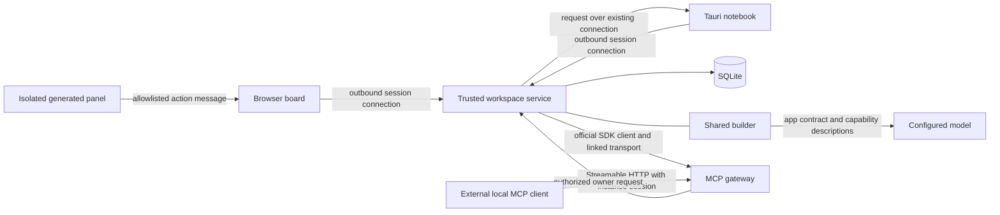

# Slice 002 architecture

This describes the implemented local demo boundary. Follow PROJECT_PLAN.v006.md for goals and deferred work.

## Ownership and persistence

- The notebook owns observations, approved synthetic screenshots, and evidence revisions.
- The board owns tasks, criticality, evidence links, and acknowledgements of exact revisions.
- Each app owns its installed package pointer and immutable package versions. Installing on the board does not install on the notebook.
- SQLite holds the authoritative demo state. Host-owned reads and actions use app/instance identity; the service persists their results. Remote ownership is expressed through contracts and enforcement, not a separate database on each machine.
- A first-start transaction migrates legacy data after a consistent backup. Legacy tables remain available for recovery; new code uses the collaboration state and app-scoped package tables.

## A read and an edit

1. A local client bootstraps and registers a known app, receiving an instance session. A one-use short-lived ticket attaches its outbound WebSocket connection.
2. Discovery returns app identities, presence, and capability descriptions. A user explicitly allows linked notebook evidence before the board reads it. The service checks the workspace, grant, target capability, and entity link at every invocation.
3. The runtime uses an official MCP SDK client to call read_observation on the gateway. The gateway routes the call over an existing owner connection; the owner reads its observation through its scoped service route and replies. The service checks the reply against authoritative stored data.
4. The notebook saves an edit with expected revision and operation ID. A transaction increments the revision; repeating the same operation returns its prior result, while conflicting operation reuse or stale edits are rejected.
5. An authorized, linked consumer receives a minimal revision notification, then refreshes through the capability read. Events carry identity/revision metadata rather than the full observation body.
6. The host calculates installed review behavior for workspace state independently of the panel frame. Acknowledgement checks the latest authoritative revision; acknowledging N never clears N+1.

The runtime-to-gateway transport is SDK in-memory JSON-RPC within the service. The outward owner connection is WebSocket. External local clients can use the SDK's stateless Streamable HTTP endpoint at /mcp. These are distinct responsibilities; WebSocket notifications are not presented as durable MCP events. The implementation follows the official [MCP server](https://ts.sdk.modelcontextprotocol.io/server) and [client](https://ts.sdk.modelcontextprotocol.io/client) APIs pinned in package.json.

## Authoring and execution

The shared builder receives the selected app definition, linked source identities, slot contract, and a real MCP discovery result. The model generates SDK 0.2 markup layout and pure review code, or returns an explicit unsupported result. Domain requirements and behavior verification run before saving an installable draft. An explicit alternative is never installed automatically.

Data remains under host control. Generated observation bindings resolve through the approved read capability at runtime. The generated program cannot call arbitrary MCP tools; this slice's bridge exposes one evidence resource and acknowledgement action. The model receives capability metadata, not the full observation contents, during authoring.

The host compiles allowlisted UI nodes to escaped markup. It serves the markup using bounded short-lived random frame handles and an independent restrictive content policy. The iframe uses allow-scripts without allow-same-origin; it receives no API/session token or raw native command access. The parent validates message source, channel, action, task, revision, and permission. Review code executes separately in the bounded QuickJS worker.

## Limits

- Local trusted-workspace pairing is not production user authentication. A holder of the local bootstrap token can register a known workspace app. Use only on loopback.
- Two known app types and a third synthetic instance demonstrate shared contracts and generic routing. They do not establish support for arbitrary app types or schemas. The SDK remains evidence-review oriented and supports two decision policies.
- The source app must be connected for cross-app reads. Offline evidence is shown as unavailable; reconnect refreshes authoritative state. No cross-app offline cache guarantee is made.
- Session status is process-local and bounded to 64 registrations per service run. Packages, grants, revisions, and operation deduplication persist. Full session lifecycle/remote identity is later work.
- Session cancellation and interpreter limits reduce exposure; complete protection against runtime vulnerabilities is not established.
- There is no event log replay. Revision checks, operation IDs, and reconnect refresh supply the bounded demo's recovery behavior.
- Full created-agent scheduling/history, observer suggestions, arbitrary generated React/forms/actions, production deployment, and final video polish remain later work.
